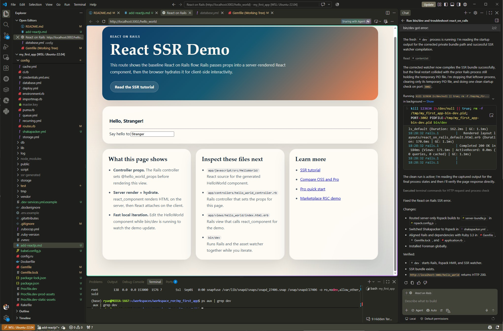

**The fastest, most reliable way to add React to an existing Rails project today is to use the official `react_on_rails` integration.**  
It gives you React + Rails + hot reloading + bundling (via Shakapacker/Rspack) with minimal setup.  
Below is the exact workflow, grounded in the current React on Rails documentation.

---

## ✅ **Concise answer**
Install the gem, run the installer, start `bin/dev`, and you’ll have React components rendering inside Rails views.

---

## 🚀 **Step‑by‑step: Add React to an existing Rails app**  
*(All steps are directly supported by React on Rails docs.)*

### **1. Add the gem**  
```bash
bundle add react_on_rails --strict
git add . && git commit -m "Add react_on_rails"
```
  [Github](https://github.com/shakacode/react_on_rails/blob/main/docs/oss/getting-started/quick-start.md)

### **2. Run the installer**  
```bash
bin/rails generate react_on_rails:install
```

If you want **Rspack** (20× faster builds), use:  
```bash
bin/rails generate react_on_rails:install --rspack
```  
  [Github](https://github.com/shakacode/react_on_rails/blob/main/docs/oss/getting-started/quick-start.md)

This generates:

- Shakapacker config  
- React component directories  
- Example controller + view  
- Webpack/Rspack bundler setup  
- Rails initializer  

### **3. Start the dev server**  
React on Rails uses `bin/dev` to run Rails + bundler with HMR:

```bash
./bin/dev
```

This starts:

- Rails at **http://localhost:3000**  
- Bundler dev server with hot reloading  
  [Github](https://github.com/shakacode/react_on_rails/blob/main/docs/oss/getting-started/quick-start.md)

### **4. Visit the example React component**  
Open:

```
http://localhost:3000/hello_world
```

You’ll see the generated React component rendered inside a Rails view.  
  [Github](https://github.com/shakacode/react_on_rails/blob/main/docs/oss/getting-started/quick-start.md)

### **5. Add your own React component**  
Create a component under the auto‑bundled directory:

```
app/javascript/src/MyComponent/ror_components/MyComponent.client.jsx
```

Rails view usage:

```erb
<%= react_component("MyComponent", props: { name: "Ryan" }) %>
```

React on Rails automatically registers components inside `ror_components`.  
  [reactonrails.com](https://reactonrails.com/docs/introduction/)

---

## 🧠 Why this method is recommended
React on Rails gives you:

- **SSR** (server‑side rendering)  
- **Hot module replacement**  
- **Rails view integration**  
- **No separate API needed**  
- **Modern bundling via Shakapacker/Rspack**  
  [reactonrails.com](https://reactonrails.com/docs/introduction/)

This is the officially supported, modern way to embed React inside Rails 7+.

---

## 🧩 Alternative: Full SPA + Rails API
If you prefer a separate React app (Vite/Next.js) + Rails API, I can outline that architecture too. But for embedding React *inside* Rails, React on Rails is the correct path.

---

